# InventoryPOS — Technical & Functional Project Documentation

**A multi-tenant Point-of-Sale and Inventory Management platform for Kenyan SMEs**

| Field | Value |
|---|---|
| Document title | InventoryPOS — Technical & Functional Project Documentation |
| Version | 1.0 |
| Date | 17 October 2026 |
| Author | Daniel Manyasa |
| Repository | `D:\InventoryPOS` |
| Primary branch | `main` |
| Solution | `InventoryPOS.sln` (5 projects) |
| Framework | .NET 8 / .NET MAUI |
| License | MIT |

> This document is the authoritative description of the InventoryPOS system. It is
> written in Markdown so that diagrams render on GitHub and in editors, and it is
> exported to Microsoft Word (`.docx`) by `scripts/export-docs.ps1`, which renders
> every Mermaid diagram to a PNG so that the diagrams remain visible in Word.

---

## Document control

| Rev | Date | Change |
|---|---|---|
| 1.0 | 2026-10-17 | Initial consolidated documentation covering all 5 chapters. |

---

# Chapter 1 — Introduction, Vision and Scope

## 1.1 What InventoryPOS is

InventoryPOS is a **cross-platform Point-of-Sale (POS) and inventory management
application** built on **.NET 8 MAUI**. A single codebase produces native apps for
**Android, iOS, Mac Catalyst and Windows desktop**. Each installation is a
complete, self-contained "till": it sells products, tracks stock in real time,
manages customers, suppliers, purchase orders and branches, prints receipts, and
keeps working when the network drops.

The product is deliberately designed to be **monetisable**: every business that
signs up is treated as a **tenant**, self-registers for a **14-day free trial**,
and can pay a **monthly subscription** in Kenyan Shillings using **M-Pesa**
(through IntaSend). Subscription plans gate how many users, branches and products
a tenant may create.

## 1.2 The problem it solves

Small and medium retailers in Kenya typically face a set of concrete operational
problems that this system addresses head-on:

- **Stock and cash drift.** Sales on paper or in spreadsheets do not reconcile
  with what is physically on the shelf or in the till. InventoryPOS records every
  quantity change in an immutable **stock ledger** and captures a **Z-report** for
  cash reconciliation.
- **No fiscal compliance.** Kenyan businesses must issue receipts through
  **KRA eTIMS**. InventoryPOS submits each sale for a **fiscal receipt** and
  stores the fiscal number and signature on the sale.
- **Unreliable connectivity.** Shops often operate with intermittent internet.
  The app is **offline-first**: sales are written to the local database and pushed
  to a backup server later by an **outbox**.
- **Data theft on shared/lost devices.** Tills are shared and devices get lost.
  The system protects data with **AES-256-GCM field encryption** and optional
  **SQLCipher whole-database encryption**.
- **Affordability.** Traditional POS suites are expensive and require specialist
  hardware. InventoryPOS runs on phones and cheap Windows machines and offers a
  free tier.

## 1.3 Goals and non-goals

**Goals**

- One codebase, four platforms (Android, iOS, Mac Catalyst, Windows).
- Local-first operation with a clear, testable synchronisation path to a backend.
- Strong tenant isolation so a shared device can never leak one business's data to
  another.
- Configurable external integrations (payments, fiscalisation, cloud backup) that
  are **off by default** and enabled per business.
- A monetisation model (plans, limits, trials, renewals) built into the domain.

**Non-goals (this release)**

- A hosted backend is not included. The app talks to a plain HTTP endpoint
  (`POST /api/sales/sync`) but the server side is the adopter's responsibility.
- The eTIMS integration targets a configurable VSCU endpoint; exact field/rate
  codes vary by device firmware and may need tuning against a live sandbox.
- Reports are CSV exports; PDF/Excel generators exist as placeholders only.

## 1.4 Users and roles

The system models four roles, ordered by privilege. Authorisation is evaluated by
numeric comparison (`currentRole <= requiredRole`), so a lower enum value implies
more privilege.

| Role | Enum | Can do |
|---|---|---|
| **Admin** | 1 | Everything: manage users, branches, subscription, settings, payments, activations |
| **Manager** | 2 | Products, sales, cancel sales, delete products, move stock between branches |
| **Seller** | 3 | Create sales and products |
| **Viewer** | 4 | Read-only access |

## 1.5 Functional feature catalogue

| Area | Capabilities |
|---|---|
| **Tenancy & onboarding** | Owner self-registration, 14-day free trial, default branch/categories, per-tenant data isolation |
| **Authentication** | Username/password, PBKDF2 hashing, forced password change, account lockout, session timeout |
| **POS** | Product search, cart, discounts, tax, **split payments**, held sales, debtor credit, receipt printing |
| **Products** | CRUD, barcodes, categories, pricing, tax rate, service items, units of measure |
| **Inventory** | Stock levels, adjustments, immutable stock-movement ledger, low-stock/out-of-stock alerts |
| **Branch transfers** | Request → dispatch → receive → cancel workflow with stock custody rules |
| **Sales** | History, filtering, cancellation with stock restoration, profit calculation |
| **Customers & suppliers** | CRUD, credit limits and balances |
| **Purchase orders** | Line items, status workflow, receiving |
| **Reporting** | Sales/inventory/customer CSV exports, cash summary, Z-report, profit |
| **Subscriptions** | Plans, enforced limits, M-Pesa STK-push payment, auto/manual activation, renewal warnings |
| **Offline sync** | Local outbox, batch push, connectivity gating |
| **Fiscalisation** | KRA eTIMS sales submission and fiscal receipt data |
| **Security** | Field-level AES-256-GCM, optional SQLCipher full-database encryption |
| **Cloud backup** | Optional push of sales to a configured backend |

## 1.6 Non-functional characteristics

- **Offline-first:** every sale succeeds locally; the network is never on the
  critical path.
- **Isolation by construction:** global EF Core query filters enforce soft-delete
  and tenant scoping for every entity.
- **Least-privilege integrations:** only client-safe keys (IntaSend publishable
  key) ship in the app; secrets belong on a backend.
- **Resilience:** fiscalisation and sync failures never block a sale.
- **Portability:** identical behaviour on phone, tablet and desktop.

## 1.7 Technology stack

| Layer | Choice |
|---|---|
| Language / runtime | C# / .NET 8 |
| UI framework | .NET MAUI (XAML + MVVM) |
| MVVM toolkit | CommunityToolkit.Mvvm 8.4.2 |
| Data access | Entity Framework Core 8.0.13 (SQLite provider) |
| Local database | SQLite, optionally SQLCipher-encrypted |
| Crypto provider | SQLitePCLRaw.bundle_e_sqlcipher 2.1.10 |
| JSON | Newtonsoft.Json 13.0.4 |
| Tests | xUnit 2.5.3, coverlet 6.0.0 |
| Payments | IntaSend (M-Pesa STK push) |
| Fiscalisation | KRA eTIMS (VSCU) |

## 1.8 System context

The diagram below shows the actors, the application, and every external system it
can talk to.

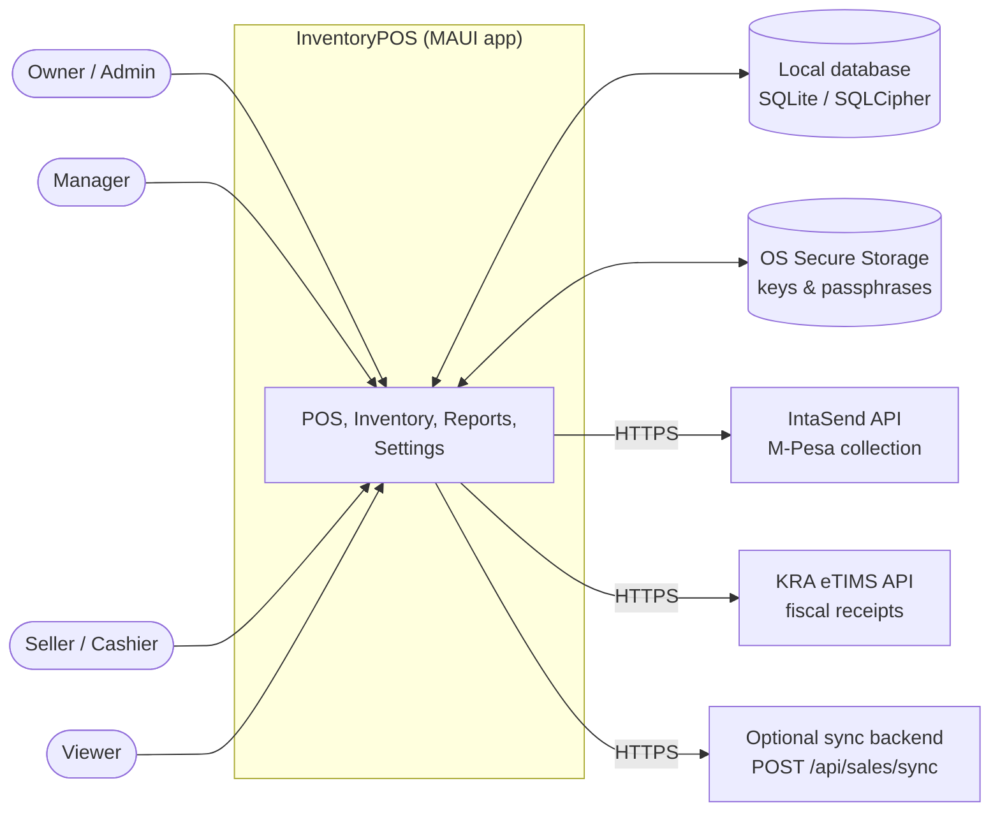

## 1.9 Subscription plans

Limits are enforced at runtime by `SubscriptionService`. Paid plans renew on a
30-day cycle.

| Plan | Users | Branches | Products | Price / month |
|---|---|---|---|---|
| Free | 2 | 1 | 100 | Free |
| Basic | 5 | 3 | 1,000 | KES 500 |
| Pro | 20 | 10 | 10,000 | KES 1,500 |
| Enterprise | Unlimited | Unlimited | Unlimited | KES 5,000 |

---

# Chapter 2 — System Architecture

## 2.1 Architectural style

InventoryPOS is a **layered, MVVM desktop/mobile application** with a clean
dependency direction: presentation depends on application and domain services,
which depend on persistence, and everything ultimately depends on a shared core
of entities, enums, exceptions and utilities. There is **no server component in
the box**; the app is the system of record for a single business and optionally
communicates outward.

The core principles are:

1. **Separation of concerns** — UI (XAML) is separated from logic (ViewModels) and
   from data access (services backed by EF Core).
2. **Inversion of control** — every service is registered in a DI container
   (`MauiProgram`) and injected via interfaces.
3. **Local-first** — the SQLite database is authoritative; integrations are
   additive and non-blocking.

## 2.2 Solution and project structure

The solution contains five projects, all under `src/`:

```
src/
  InventoryPOS.Core        Domain: entities, enums, exceptions, utilities, tenancy
  InventoryPOS.Data        EF Core DbContext, repositories, seed data, migrations
  InventoryPOS.Services    Subscriptions, Accounts, Mpesa, eTIMS, Sync, Reporting
  InventoryPOS.Maui        MAUI app: Views, ViewModels, Services (auth, data, print, sync)
  InventoryPOS.UnitTests   xUnit tests (Core, Data, Services layers)
database/                  Local database assets (InventoryPOS.db, Schema.sql)
scripts/                   Build & helper scripts (incl. docs export)
docs/                      Documentation (this file, API, schema, deployment)
signing/                   Android keystore and Windows PFX for releases
```

Project dependencies:

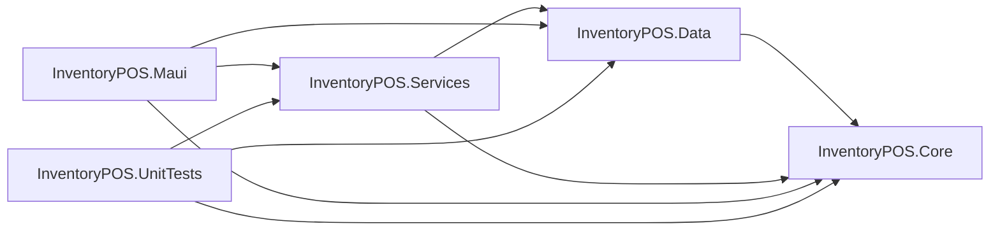

Note that `InventoryPOS.UnitTests` intentionally does **not** reference the MAUI
project: the MAUI project targets mobile/desktop TFMs and cannot be loaded by the
`net8.0` test host. This shapes the testing strategy (see Chapter 5) — business
logic that must be unit-tested lives in `Core`, `Data` and `Services`.

## 2.3 Layered architecture

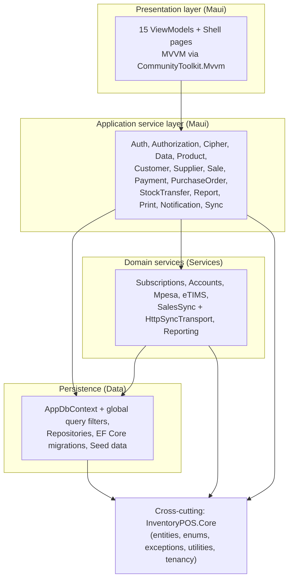

## 2.4 Deployment view

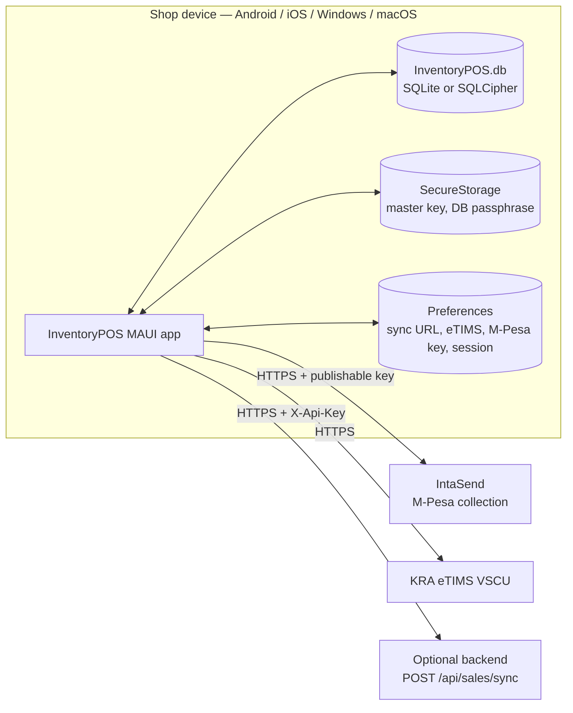

## 2.5 Dependency injection composition root

`MauiProgram.CreateMauiApp()` is the single composition root. Its registrations,
in order, are:

- **Tenancy & database:** `ITenantContext` (singleton), `DatabaseEncryptionService`
  (singleton, initialised at startup), `SqliteConnectionFactory` (singleton), and
  `AppDbContext` built from the factory's connection string.
- **Platform helpers:** `LocalStorageService`, `PreferencesService`.
- **Payments:** `MpesaOptionsProvider`, `IMpesaClient` → `MpesaClient`,
  `ISubscriptionPaymentService` → `SubscriptionPaymentService`.
- **Fiscal:** `EtimsOptionsProvider`, `IEtimsClient` → `EtimsClient`,
  `IEtimsService` → `EtimsService`.
- **Repositories:** generic `IRepository<>` → `BaseRepository<>` plus specific
  repositories (customer, sale, user, product, supplier, purchase order).
- **Application services:** data, auth, business, cipher, subscription, account,
  inventory, customer, supplier, sale, authorization, payment, notification,
  print, report, purchase order, stock transfer, stock alerts.
- **Sync:** `IConnectivity`, `ISyncTransport` → `HttpSyncTransport`,
  `SalesSyncService`, `SyncOptionsProvider`, `ISyncService` → `SyncService`.
- **ViewModels and Pages:** all transient.

Lifecycle choices matter: `AppDbContext` and most application services are
**scoped**, `TenantContext`, the connection factory, encryption service and the
options providers are **singletons**, and the connectivity abstraction is a
singleton wrapping `Connectivity.Current`.

## 2.6 Application startup sequence

Startup runs the database bootstrap and seeding, restores the tenant for a
persisted session, then routes to the login screen.

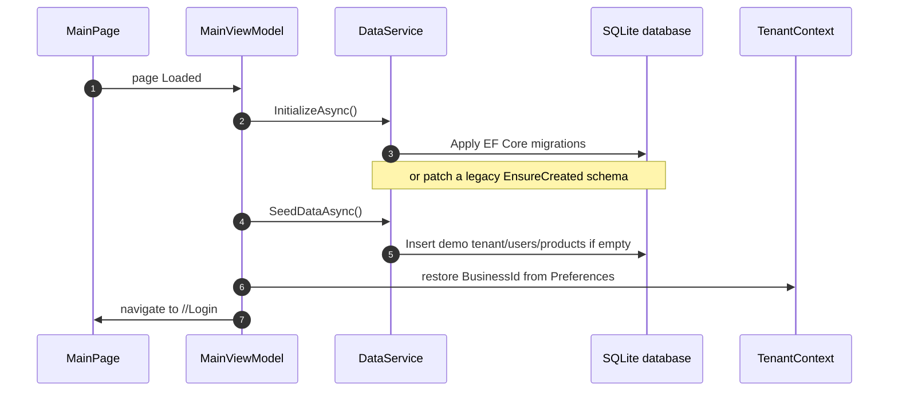

`DataService.InitializeAsync()` is deliberately defensive. It handles three cases:
a database with no migrations (created via `EnsureCreated`), a normal database
with an EF migrations-history table, and a **legacy** database created by an early
`EnsureCreated` build. For the legacy case it adds any missing columns and marks
all migrations as applied so future migrations continue from a known baseline.

## 2.7 Request/response flow through the layers

A representative read (loading the dashboard) and a representative write (a sale)
both follow the same path: View/ViewModel → application service → EF Core
`DbContext` → SQLite, with global query filters silently enforcing tenant and
soft-delete rules on every statement.

## 2.8 Configuration and options providers

Per-installation settings are held in platform `Preferences` and resolved at call
time through small provider classes, which keeps secrets and environment-specific
values out of the UI and out of source control.

| Provider | Preferences keys | Purpose |
|---|---|---|
| `MpesaOptionsProvider` | `IntaSendPublishableKey`, `IntaSendSandbox` | M-Pesa collection |
| `SyncOptionsProvider` | `SyncBaseUrl`, `SyncApiKey` | Cloud backup endpoint |
| `EtimsOptionsProvider` | `EtimsBaseUrl`, `EtimsTin`, `EtimsBranchId`, `EtimsDeviceSerial`, `EtimsClientId`, `EtimsClientSecret` | KRA fiscalisation |

Sensitive keys and session state are stored in **OS secure storage** (Keychain /
Keystore via MAUI `SecureStorage`): the device master key, the SQLCipher
passphrase, and session identifiers.

---

# Chapter 3 — Data Model and Persistence

## 3.1 Overview

Persistence is **Entity Framework Core 8** against **SQLite**. The database file
lives at `FileSystem.AppDataDirectory/InventoryPOS.db` and is created and upgraded
from **EF Core migrations** on first run. The domain model is made of 20 entities
that all derive from `BaseEntity`, giving every row an identity plus audit and
soft-delete columns (`Id`, `CreatedAt`, `UpdatedAt`, `IsDeleted`).

## 3.2 Entity-relationship model

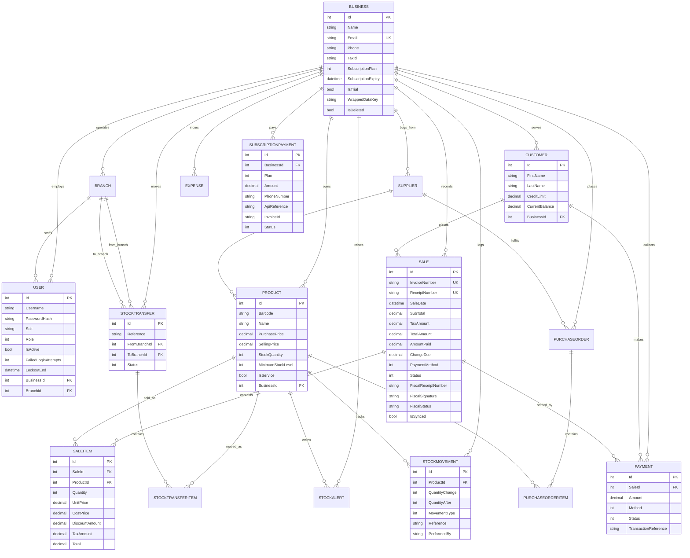

## 3.3 Tenancy and soft-delete strategies

Tenant isolation is enforced **in the data layer**, not just the UI, so a coding
mistake in a ViewModel cannot expose another business's rows. This is implemented
in `AppDbContext.ApplyGlobalFilters` using reflection over every entity that
derives from `BaseEntity`:

1. A **soft-delete filter** (`!IsDeleted`) is applied to every `BaseEntity`.
2. If the entity exposes an `int BusinessId` property, a **tenant filter** is
   added: `BusinessId == CurrentTenantId`, unless `CurrentTenantId == 0`, in which
   case the tenant predicate is bypassed.

The rule that `Business` itself only receives the soft-delete filter (it has no
`BusinessId`) is intentional. The `null`/`0` bypass exists so infrastructure code
— seeding and sign-in — can operate across tenants. `AuthService.LoginAsync`
explicitly calls `.IgnoreQueryFilters()` to find a user before a tenant is known,
then activates the tenant for the rest of the session.

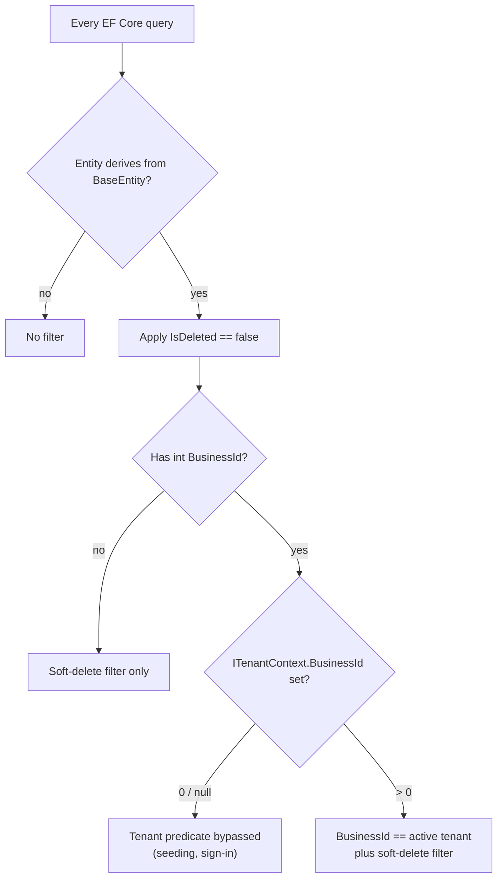

`CurrentTenantId` is read from the singleton `ITenantContext` and is evaluated
**per query**, so changing the active tenant is immediately reflected without
recreating the `DbContext`.

## 3.4 Migrations

The schema is versioned by seven EF Core migrations:

| # | Migration | Adds |
|---|---|---|
| 1 | `InitialCreate` | Core tables (businesses, products, sales, customers, etc.) |
| 2 | `AddMultiTenancyAndSubscriptions` | Tenant and subscription columns/plans |
| 3 | `AddSubscriptionPayments` | `SubscriptionPayments` table |
| 4 | `AddStockMovements` | `StockMovements` ledger + indexes |
| 5 | `AddSaleItemCostPrice` | `SaleItems.CostPrice` (profit calculation) |
| 6 | `AddStockTransfers` | `StockTransfers` + `StockTransferItems` |
| 7 | `AddFiscalReceiptFields` | Fiscal columns on `Sales` (eTIMS) |

Migrations are authored with the EF tools and applied automatically at startup:

```powershell
dotnet ef migrations add <Name> `
  -p src\InventoryPOS.Data\InventoryPOS.Data.csproj `
  -s src\InventoryPOS.Data\InventoryPOS.Data.csproj
```

## 3.5 Repository pattern

`IRepository<T>` / `BaseRepository<T>` provide a small, testable persistence API
(get by id, find, count, add, update, delete, save). Specialised repositories
(`ProductRepository`, `SaleRepository`, `CustomerRepository`, `UserRepository`,
`SupplierRepository`, `PurchaseOrderRepository`) add query methods specific to
their aggregate. Services may also inject `AppDbContext` directly for transactional
work — for example, `SaleService` opens a transaction and mutates products, stock
movements, payments and the sale in a single unit of work.

## 3.6 Encryption at rest

InventoryPOS protects data at **two independent levels**, both optional and
backward-compatible.

### 3.6.1 Field-level encryption (always available)

`CipherService` implements per-business field encryption using `EncryptionHelper`
(AES-256-GCM, 32-byte key, 12-byte nonce, 16-byte tag; ciphertext is
`base64(nonce ‖ ciphertext ‖ tag)`). The **key hierarchy** is:

1. A **device master key** is generated once and stored in OS secure storage.
2. Each business gets a random **data key**, stored **wrapped** (encrypted with the
   master key) in `Business.WrappedDataKey`. The raw data key is never written.
3. Sensitive fields are encrypted with the unwrapped business data key.

Because GCM is authenticated, tampered ciphertext is rejected on decryption. The
same primitive also powers password-independent key wrapping.

### 3.6.2 Whole-database encryption (SQLCipher, opt-in)

`DatabaseEncryptionService` adds optional **full-database encryption**:

- The app ships **SQLCipher** (`SQLitePCLRaw.bundle_e_sqlcipher`) instead of plain
  SQLite.
- Enabling encryption generates a random 32-byte passphrase, stores it in secure
  storage, and **migrates the existing plaintext database in place** using
  `ATTACH DATABASE … KEY …` followed by `sqlcipher_export`.
- A **restart is required** so new connections use the key.
- By default no passphrase is stored and the database remains a plain SQLite file,
  so existing installations keep working untouched.
- `SqliteConnectionFactory` attaches the passphrase to the connection string only
  when encryption is active, and always sets `Foreign Keys=True`.

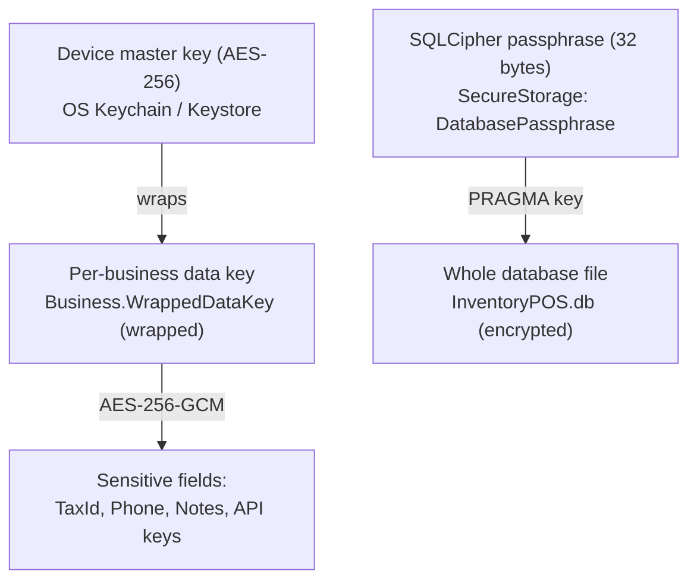

## 3.7 Seed data

`DatabaseSeeder` provisions a **demonstration tenant** the first time the app
runs: sample businesses (`GMNEX Business Solutions`, `SmartP Kenya`,
`Scholars Comfort`, `LUSI Stores`), three users (`admin`, `manager`, `seller`), a
set of categories, products, customers and suppliers. Seeded users are created
with `RequiresPasswordChange = true`, forcing a password change at first sign-in.
Registration of a new business seeds a default "Main" branch and three default
categories automatically.

---

# Chapter 4 — Functional Modules and Application Services

This chapter walks through each functional area from the user's perspective and
names the code that implements it.

## 4.1 Authentication and authorisation

**Sign-in flow.** `LoginViewModel` collects credentials and calls
`AuthService.LoginAsync`. The service finds the user across tenants
(`IgnoreQueryFilters`), rejects locked accounts, verifies the PBKDF2 hash, and on
success checks that the tenant's subscription is active
(`SubscriptionService.EnsureActiveAsync`). It then records the session in secure
storage, updates `LastLoginAt`/`IsOnline`, and **activates tenant isolation** by
setting `ITenantContext.BusinessId`. First-time users are prompted to change their
seeded password before continuing.

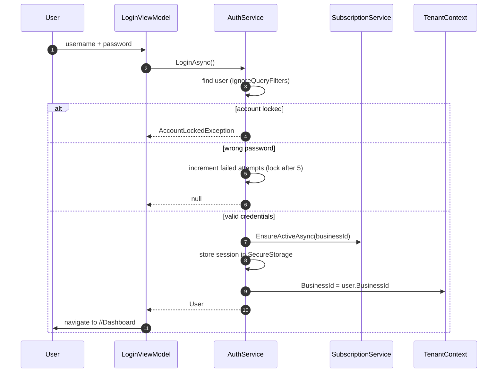

**Password and session policy.**

- Passwords are hashed with **PBKDF2-SHA256, 100,000 iterations**, a 32-byte
  per-user salt, and fixed-time comparison.
- Password policy: minimum 8 characters with upper and lower case, a digit and a
  special character.
- **5 failed logins** trigger a **15-minute lockout**.
- Sessions expire after **8 hours**; `GetCurrentUserAsync` detects expiry and logs
  the user out.

**Authorisation.** `AuthorizationService` exposes intent-named checks
(`CanManageProductsAsync`, `CanCancelSalesAsync`, `CanManageSettingsAsync`, …)
built on `HasPermissionAsync(requiredRole)` with the numeric role comparison.
Services re-check permissions server-side (e.g. `SaleService.CancelSaleAsync`
requires Manager; `StockTransferService` requires product-management rights), so
UI visibility is never the only guard.

## 4.2 Point of Sale and the sales lifecycle

The POS screen (`POSViewModel` / `POSPage`) supports product search, a cart,
manual discounts, tax, **split payments**, **held sales**, debtor credit and
receipt printing. Completing a sale is a single transactional unit of work:

1. The sale is marked `Completed`.
2. For each cart line the product's stock is decremented, guarded against
   insufficient stock, and a **stock-movement ledger** record is written.
3. Payments are recorded for each tender (the whole payment, or per-split).
4. The transaction commits, then low-stock alerts are evaluated.
5. **Best-effort** KRA eTIMS submission runs and, if configured, stores the fiscal
   receipt number/signature/status on the sale.

A fiscal or network failure never rolls back the sale — resilience is a hard rule.

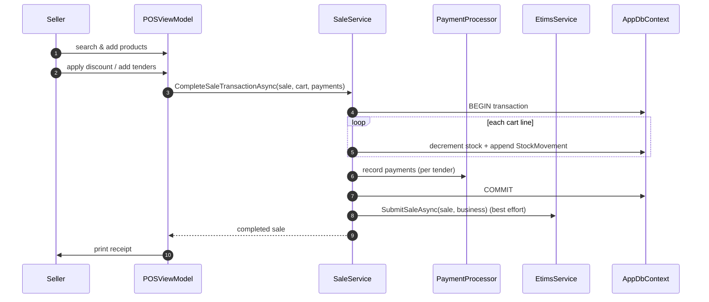

**Split payments.** A sale can be settled by more than one tender. Each
`PaymentTender` (method, amount, reference) is processed individually and a
`Payment` row is written per tender; the debtor case carries any outstanding
balance.

**Held sales.** A sale in progress can be parked ("held") and resumed later
without losing the cart.

**Cancellation.** Cancelling a completed sale restores stock (writing reversal
movements marked `SaleCancelled`) and requires Manager rights.

## 4.3 Inventory and the stock ledger

Every quantity change is written to the immutable `StockMovements` table with the
change, the resulting balance (`QuantityAfter`), the movement type, a reference
and the operator. Stock changes happen through `StockLedger.Record`, so a mutation
and its audit record are committed together. Movement types include Opening, Sale,
SaleCancelled, Refund, Purchase, Adjustment, TransferIn and TransferOut.

`StockAlertService` scans a business's products after stock-affecting operations
and creates `LowStock`/`OutOfStock` alerts (de-duplicated) when quantity falls to
or below the minimum level. Alerts are acknowledged through the inventory UI.

## 4.4 Branch stock transfers

Head offices move stock between branches with a custody-aware workflow.
Transfers are created as `Pending`; dispatching **removes** stock from the source
and moves the transfer to `InTransit`; receiving **adds** stock to the destination
and moves it to `Received`. Cancelling an in-transit transfer **returns the stock
to the source**. Quantities must be positive and the two branches distinct.

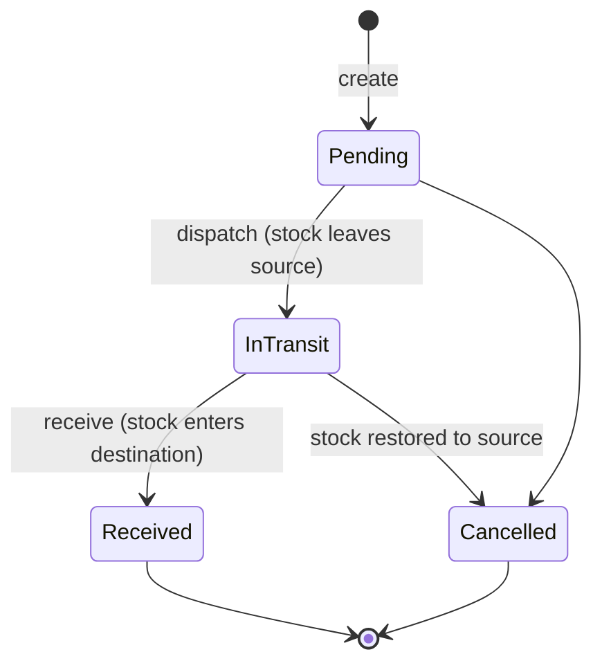

## 4.5 Products, customers, suppliers and purchase orders

- **Products** support barcodes (unique per business), categories, purchase and
  selling prices, tax rate, unit of measure, service items (no stock), and derived
  stock status. Adding a product respects the tenant's product limit and records an
  opening stock movement.
- **Customers** carry contact details, credit limits and running balances (used by
  debtor sales). **Suppliers** are simple master records.
- **Purchase orders** have line items and a Draft → Submitted → Approved →
  Received → Cancelled workflow, with receiving that feeds stock back in.

## 4.6 Reporting

`ReportService` produces **CSV** exports to the app cache directory and returns
the path so the UI can share or open the file:

- **Sales report** (invoices, totals, method, status, profit).
- **Inventory report** (prices, stock, stock value).
- **Customer report** (contact, credit limit, balance).
- **Cash summary** and **Z-report** (cash in, refunds, expected vs counted cash,
  variance).
- **Profit** (revenue minus cost of goods sold, using `SaleItems.CostPrice`).

`PdfReportGenerator` and `ExcelReportGenerator` exist as placeholders for future
richer output.

## 4.7 Subscriptions and M-Pesa billing

Self-registration starts a **14-day Free trial**. Upgrading or renewing a paid
plan triggers an **IntaSend STK push** (Lipa na M-Pesa Express). A
`SubscriptionPayment` is recorded as `Pending`, the customer approves on their
phone, and activation happens either **automatically** (polling IntaSend's payment
status by `invoice_id`) or **manually** by an admin on the Manual Activations
page. Admin settings show a **renewal warning** as the expiry approaches. Phone
numbers are normalised to the `2547…` format before submission.

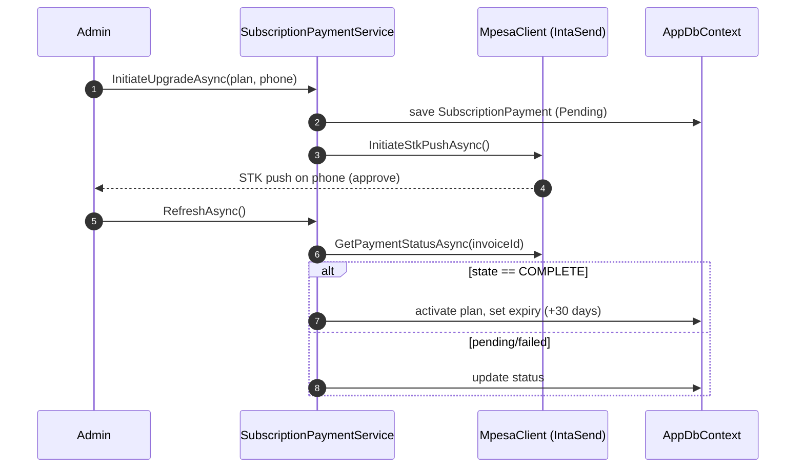

Only IntaSend's **publishable key** ships in the app. `IMpesaClient` also
implements `IsValidWebhook` (fixed-time challenge comparison) for when a backend
is added to receive webhook confirmations.

## 4.8 Offline sync (outbox)

Sales are the sync unit. The **database itself is the queue**: a sale is pending
whenever `IsSynced` is false. `SalesSyncService.PushPendingAsync` selects up to
**200** pending sales with their items, posts them via `HttpSyncTransport` to
`POST {BaseUrl}/api/sales/sync` (optionally with an `X-Api-Key` header), and marks
them synced **only after** the transport succeeds. `SyncService` (MAUI) gates the
push on `IConnectivity` reporting internet access. A crash or dropped connection
simply leaves the sales queued for the next attempt.

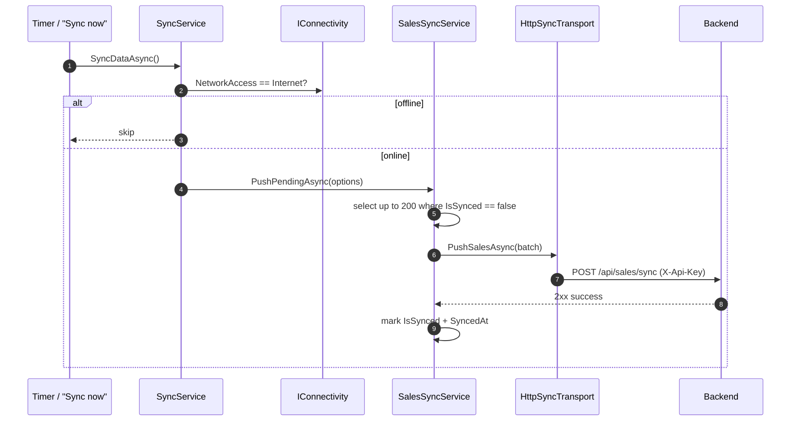

## 4.9 KRA eTIMS fiscalisation

When configured, each completed sale is mapped to the eTIMS sales schema by
`EtimsService.BuildInvoice` (a pure, unit-tested mapping) and submitted by
`EtimsClient` to `USER/api/trnsSales/saveSales`. The response's `resultCd == "000"`
indicates success and carries the fiscal receipt number (`rcptNo`), internal data
and signature. These are stored on the sale (`FiscalReceiptNumber`,
`FiscalInternalData`, `FiscalSignature`, `FiscalStatus`) and printed on the
receipt. When eTIMS is not configured, submission is skipped silently.

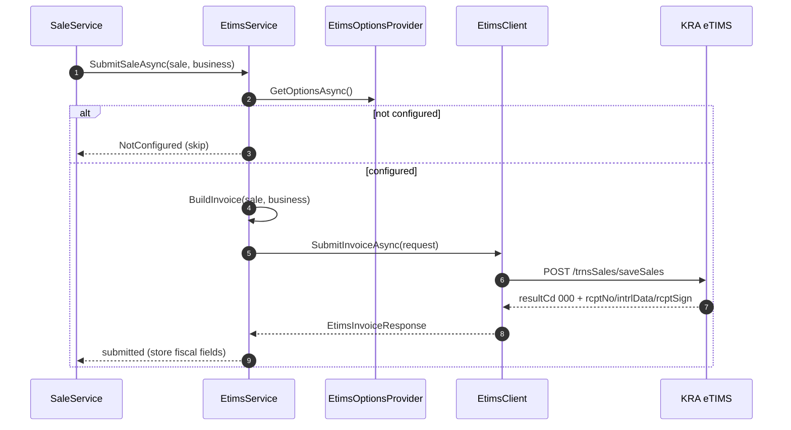

## 4.10 Printing

`ReceiptPrinterService` renders a receipt as HTML and shares it via the platform
share sheet; when fiscal data is present it includes the KRA receipt number and
signature, and shows a "pending" note when a fiscal submission failed.
`BarcodeLabelService` and `ThermalPrintService` are present as placeholders for
label and ESC/POS thermal printing.

## 4.11 Navigation and screens

`AppShell` defines the route structure: a bootstrap `MainPage` (init), `Login`,
`Register`, a Home tab bar (Dashboard, POS, Products), a Manage tab bar
(Inventory, Sales, Customers), and standalone routes for Suppliers, Purchase
Orders, Branch Transfers, Reports, Settings and Manual Activations.

---

# Chapter 5 — Security, Quality, Operations and Roadmap

## 5.1 Security model

| Concern | Control |
|---|---|
| Password storage | PBKDF2-SHA256, 100k iterations, per-user 32-byte salt, fixed-time compare |
| Brute force | 5 attempts → 15-minute lockout |
| Session | 8-hour timeout, session state in secure storage |
| Transport of secrets | Only client-safe keys in-app; IntaSend secret/webhook challenge server-side; `IsValidWebhook` fixed-time comparison |
| Data at rest (fields) | AES-256-GCM with per-business data key wrapped by a device master key |
| Data at rest (database) | Optional SQLCipher full-database encryption; passphrase in secure storage |
| Tenant isolation | Global EF Core query filters on every `BaseEntity` with `BusinessId` |
| Auditability | Immutable stock-movement ledger; fiscal data retained on sales |
| Least privilege | Intent-named `Can…` authorisation checks re-verified in services |

## 5.2 Testing strategy and current coverage

Tests live in `InventoryPOS.UnitTests` and run against the `Core`, `Data` and
`Services` layers (the MAUI project is intentionally out of scope). The suite
currently contains **9 test classes** and **44 passing tests**, roughly:

| Test class | Focus |
|---|---|
| `EncryptionHelperTests` | AES-256-GCM encrypt/decrypt, key wrapping, tamper rejection |
| `DatabaseEncryptionTests` | SQLCipher: encrypted file has no SQLite header; wrong/absent key fails; correct key reads |
| `SubscriptionPlansTests` | Plan limits and pricing |
| `AccountServiceTests` | Tenant registration and provisioning |
| `SubscriptionPaymentServiceTests` | Payment records and activation logic |
| `MpesaClientTests` | IntaSend client request/response handling |
| `SalesSyncServiceTests` | Outbox batching and mark-synced behaviour |
| `EtimsServiceTests` | Invoice mapping, endpoint/headers, success and rejection parsing |
| `TenantIsolationTests` | Query filters scope rows to the active tenant (incl. stock transfers) |

Run the suite with:

```powershell
dotnet test src\InventoryPOS.UnitTests\InventoryPOS.UnitTests.csproj
```

## 5.3 Build, run and deployment

**Prerequisites**

- .NET 8 SDK with the `maui` workload (`dotnet workload install maui`).
- Android builds: JDK 17 and the Android SDK (platform 34, build-tools 34.0.0).
- iOS / Mac Catalyst builds require macOS with Xcode.

**Windows desktop**

```powershell
dotnet build src\InventoryPOS.Maui\InventoryPOS.Maui.csproj -f net8.0-windows10.0.19041.0
dotnet run   --project src\InventoryPOS.Maui -f net8.0-windows10.0.19041.0
```

**Android**

```powershell
dotnet build src\InventoryPOS.Maui\InventoryPOS.Maui.csproj -f net8.0-android -c Release
```

Signing material for releases is kept in `signing/` (`inventorypos.keystore`,
`inventorypos.pfx`). Never commit production secrets; rotate keys if a device or
keystore is compromised.

**Target platform minimums:** iOS 11.0, Mac Catalyst 13.1, Android 21.0,
Windows 10 (10.0.17763.0).

## 5.4 Operations

- **First run:** the app creates the SQLite database, applies migrations, seeds
  demo data, and routes to Login. Demo users are forced to change their password.
- **Reset:** delete `InventoryPOS.db` from the app data folder and restart.
- **Enabling encryption:** Settings → Security → *Encrypt database*, then restart.
  Losing the secure-storage passphrase renders the database unreadable.
- **Configuring integrations:** Settings exposes Cloud Backup (sync URL/API key),
  Payment Settings (IntaSend publishable key/sandbox) and KRA eTIMS fields.
- **Cloud backup:** requires an external endpoint accepting
  `POST /api/sales/sync`.

## 5.5 Known limitations and placeholders

The following are intentionally non-functional placeholders at this version and
are empty files in the tree:

- `InventoryPOS.Services\Reporting\PdfReportGenerator.cs`
- `InventoryPOS.Services\Reporting\ExcelReportGenerator.cs`
- `InventoryPOS.Services\Cloud\CloudStorageService.cs`
- `InventoryPOS.Services\Cloud\SyncHubService.cs`
- `InventoryPOS.Maui\Services\Remote\{ApiClient,OnlineDatabaseService,SyncService}.cs`
- `InventoryPOS.Maui\Services\Local\{LocalDatabaseService,SqliteService}.cs`
- `InventoryPOS.Maui\Services\Sync\{SyncManager,ConflictResolver,OfflineQueueService}.cs`
- `InventoryPOS.Maui\Services\Print\{BarcodeLabelService,ThermalPrintService}.cs`
- `InventoryPOS.Maui\Helpers\{BarcodeScannerHelper,CameraHelper}.cs`
- Legacy duplicate model classes under `InventoryPOS.Maui\Models\*`.

There is **no conflict resolution** in sync yet (append-only push), no server
component, and barcode/camera hardware integration is not implemented (the POS
uses search instead of scanning).

## 5.6 Roadmap

1. **Backend service** for multi-device sync, webhook-confirmed payments and
   central reporting, plus true conflict resolution.
2. **Richer reporting** — real PDF/Excel generation and scheduled email reports.
3. **Hardware integration** — barcode scanners, ESC/POS thermal printers, cash
   drawers, weighing scales.
4. **eTIMS hardening** — align payload codes with the target device firmware and
   add a sandbox certification harness.
5. **Inventory depth** — batches/expiry tracking, multi-location stock on hand.
6. **Observability** — structured logging and health/diagnostic screens.

## 5.7 Glossary

| Term | Meaning |
|---|---|
| **Tenant** | A business; the unit of data isolation and billing |
| **STK push** | Safaricom "Lipa na M-Pesa" prompt sent to a customer's phone |
| **eTIMS** | Kenya Revenue Authority electronic Tax Invoice Management System |
| **VSCU** | Virtual Sales Control Unit; the eTIMS device profile |
| **Outbox** | The set of locally-recorded sales not yet pushed to the backend |
| **Z-report** | End-of-day cash reconciliation summary |
| **SQLCipher** | SQLite build with transparent full-database encryption |

## 5.8 Appendix A — Repository tree

```
D:\InventoryPOS
├─ InventoryPOS.sln
├─ README.md
├─ LICENSE
├─ docs/                     (this document, API, schema, deployment)
├─ database/                 (InventoryPOS.db, Schema.sql)
├─ scripts/                  (seed-data.ps1, setup-database.ps1, export-docs.ps1)
├─ signing/                  (Android keystore, Windows PFX)
└─ src/
   ├─ InventoryPOS.Core/
   ├─ InventoryPOS.Data/
   ├─ InventoryPOS.Services/
   ├─ InventoryPOS.Maui/
   └─ InventoryPOS.UnitTests/
```

## 5.9 Appendix B — Key package versions

| Package | Version |
|---|---|
| Microsoft.EntityFrameworkCore.Sqlite.Core | 8.0.13 |
| Microsoft.EntityFrameworkCore.Design / Tools | 8.0.13 |
| SQLitePCLRaw.bundle_e_sqlcipher | 2.1.10 |
| CommunityToolkit.Mvvm | 8.4.2 |
| Newtonsoft.Json | 13.0.4 |
| Microsoft.Maui.Controls | `$(MauiVersion)` |
| Microsoft.Extensions.Logging.Debug | 8.0.1 |
| xunit | 2.5.3 |
| Microsoft.NET.Test.Sdk | 17.8.0 |
| coverlet.collector | 6.0.0 |

---

*End of document.*
